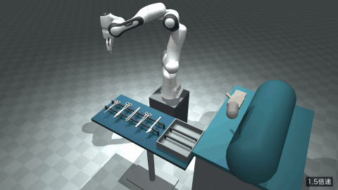
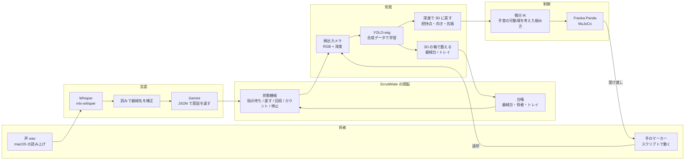
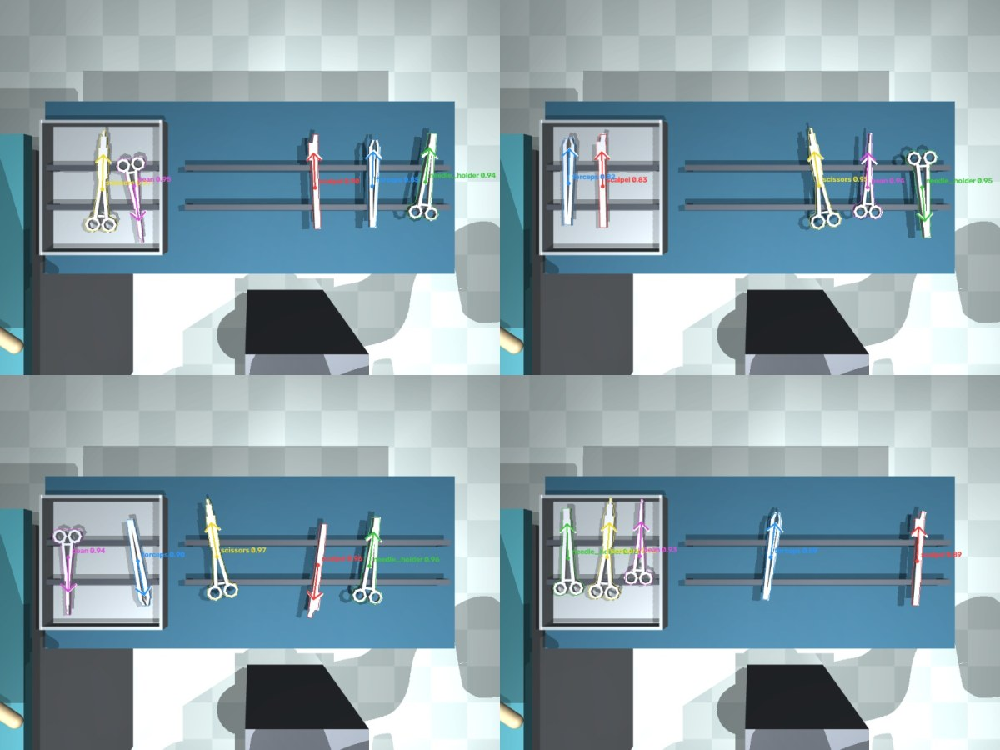

# ScrubMate — 声で渡し、目で数える器械出しロボット

手術室の「器械出し看護師」の仕事を手伝うロボットアームの MuJoCo シミュレーション。
術者の声で器械を渡し、返された器械を片付け、閉創前には器械を画像で数えて台帳と照合する。
数が合わなければ「持針器1本未返却。確認してください」と知らせて止まる。



- **デモ動画: https://youtu.be/QuQ808LdvgI** (2 分 41 秒。ロボットが動く本編は 1.5 倍速、イントロと結果の画面は等倍)
- 実機は使っていない。すべてシミュレーション (MuJoCo + Franka Emika Panda)

## 背景と目的

器械出し看護師は、術者が求める器械を素早く渡しながら、すべての器械の所在を管理し、置き忘れを防ぐ。
しかし手術室は忙しく、人の注意には限りがある。数え間違いや記録の誤りは起こりうる。

- 手術で器械やガーゼが体内に残る頻度は、米国の医療機関の調査で 5,500 件に 1 件。置き忘れが見つかった患者の 62% では、カウントは「合っている」とされていた (Cima RR et al. J Am Coll Surg 2008;207:80-7)。
- 入院手術全体では 8,800〜18,760 件に 1 件という報告もある (Gawande AA et al. N Engl J Med 2003;348:229-35)。

ScrubMate は、渡す作業を引き受けながら、器械の所在を「記録 (台帳)」と「目 (カメラ)」の二重で見張る。
看護師が患者と術野に集中でき、置き忘れも防げることを目指した。

## できること

| 場面 | ScrubMate の動き |
|---|---|
| 「器械カウントお願いします」 | 器械台を撮って 5 本を数え、初期在庫として記録する |
| 「メス」「鑷子ちょうだい」 | カメラで器械を見つけ、物理接触で掴み、持ち手を術者に向けて渡す |
| 「次」「縫合するのであれ取って」 | 術式の工程表と、術者が今持っている器械から、次に要る器械を推定する (止血 → ペアン、縫合 → 持針器) |
| 術者がトレイに器械を返す (無言) | 指示待ちの間にトレイを見張り、返却を台帳に記録して器械台に戻す。回収の途中で指示が来たら、今の 1 本を置いてから応じる |
| 「閉創前カウント」 | 器械台とトレイを数えて照合する。合わなければトレイの器械を並べ直して数え直し、それでも合わなければ警告して止まる |
| 持針器を返して「もう一度カウントお願いします」 | 数え直して一致したら「カウント一致。5本すべて確認しました」 |

## 構成



- 把持目標はすべてカメラの推定から得る。シミュレーターの正解 (真値) は評価にだけ使う。
- ロボットの把持は物理接触 (摩擦) で行う。weld 拘束は、術者の手が器械を持つ瞬間 (術者側はスクリプト) にだけ使う。
- 器械 5 種は全部同じ金属色で、識別用のマーカーは付けていない。形 (上から見たシルエット) だけで見分ける。

| 部分 | 中身 | 主なファイル |
|---|---|---|
| シーン | 手術室 (器械台・浮いた支持バー・返却トレイ・術野・術者の手)、器械 5 種 (メス・持針器・鑷子・ハサミ・ペアン)、カメラ 2 台 | `sim/assets/or_scene.xml`, `sim/scene.py`, `sim/instruments.py` |
| 制御 | 微分 IK (damped least squares)・軌道生成・pick & place | `control/ik.py`, `control/motion.py`, `control/pick_place.py` |
| 知覚 | 合成データ生成 (自動ラベル・ドメインランダム化)・YOLO-seg の学習と評価・把持点の推定 | `perception/gen_dataset.py`, `perception/train.py`, `perception/locate.py` |
| 言語 | Whisper・読みでの補正・Gemini の structured output・キャッシュと予備のルール | `language/asr.py`, `language/normalize.py`, `language/interpret.py` |
| 台帳・カウント | 状態機械の台帳・画像でのカウント・照合と並べ直し | `inventory/ledger.py`, `inventory/count.py`, `inventory/procedures.py` |
| デモ | 術者のスクリプト・ロボットの頭脳・台本・動画とスライドの合成 | `demo/surgeon.py`, `demo/agent.py`, `demo/run_demo.py`, `demo/video.py`, `demo/slides.py` |

## 評価結果

すべてシミュレーター内で計測した。詳しい表と作り直し方は [docs/results.md](docs/results.md)。

| 項目 | 結果 |
|---|---|
| 検出 (本番の重み、検証 300 枚) | mask mAP50 0.995 / mask mAP50-95 0.833。腕を待避させた画像のカウント一致 100% |
| 把持点の推定 (250 回) | 位置誤差 平均 2.2mm / 最大 8.0mm、先端の向きの正解 100%、見逃し 0 |
| pick & place (カメラの推定で掴む、ランダムな置き方 30 通り) | **300 / 300 回成功**、置き位置の誤差 平均 2.2mm (真値で掴んだ場合は 1.4mm) |
| 器械名の聞き取り (デモの声) | 補正前 9 / 18 → 読みで補正後 18 / 18。意図の解釈は Gemini 23 / 23、予備のルール 23 / 23 |
| 照合カウント (ランダム 60 場面) | 警告の内容が正しい 98.3% (並べ直しなし 91.7%)、誤警告 1 / 28 |
| 足りない器械の見逃し (器械が足りない 51 場面) | **0 / 51** |
| 受け渡しと回収 (デモと同じ頭脳、90 回) | 渡す 90 / 90、トレイからの回収 87 / 90 (失敗 3 回は壁際の器械で、3 回とも人に知らせた)、台帳は 90 回とも実物と一致 |



カメラの推定 (色付きの矢印 = 把持点と先端の向き) と、シミュレーターの真値 (白い矢印)。

## 工夫した点

**知覚**
- 学習データは MuJoCo の segmentation 描画で自動ラベルを作った (人手のアノテーションなし)。置き方・欠品・照明・天板の色・カメラ位置・腕の写り込みを毎枚変えた (ドメインランダム化)。ランダム化を切ると mask mAP50-95 が 0.855 → 0.783 に落ちた。
- 練習していない状況 (トレイで器械が重なる) は、物理で器械を落として重ねた画像を足して学び直した (重なりのある画像のカウント一致 72% → 85%)。
- 推定は、マスクの画素を深度で 3D に戻し、真上から見た地図に描き直してから行う (斜めから見た歪みで重心が 3mm ずれていたのが消えた)。先端の向きは、外形の幅のプロファイルを器械の形と照合して決める。自信が無いときは、背景との深度の差だけで作ったシルエットで判定し直す。

**把持と受け渡し**
- Panda の手首は ±166° しか回らない。掴み方 (2 通り) と回す向き (2 通り) の 4 通りから、手首の限界に当たらない組み合わせを選ぶ (先端を必ず決まった向きで器械台に戻せる、逆向きだった 45 回も全部正しく戻した)。
- 器械台は浮いた 2 本のバーで器械を支え、指が器械の下に回り込めるようにした。返却トレイの中にも同じバーを入れた。
- 重なった器械の上の 1 本を掴むときは掴む高さを 4.5mm 上げる (指のパッドが下の器械にかかって 2 本まとめて運んでいた)。壁際の器械は指の開きを狭める。

**言語**
- Whisper は専門用語に弱い (鑷子 →「接し」、持針器 →「自信機」、縫合 →「方向」)。書き起こしをひらがなに直し、器械名・工程名の読みとの近さで置き換えた (補正前 9/18 → 18/18)。しきい値は別の声で決め、他の 4 つの声で確かめた。
- Gemini には JSON スキーマ (structured output) で答えさせ、工程表と術者が持っている器械を状況として渡す。無料枠の回数制限に備えて、応答のキャッシュ (同梱) とキーワードの予備ルールを用意した。API キーが無くてもデモは同じ結果で動く。

**台帳とカウント (安全側に倒す)**
- 台帳は状態機械で、許される移り方 (渡す・返却・戻す) 以外はエラーにする。カメラに写る術者の手の器械は、3D 位置の箱で除いて数えない。
- 照合が合わなければ、トレイの器械を上から 1 本ずつ並べ直してから数え直す (実際の手術室でも、並べてから数える)。
- 「重なりが残った」「台帳では術者が持っている器械が見えた」「同じ器械が 2 か所に見えた」ときは、「一致」と言わずに警告する。誤警告は人が確かめれば済むが、見逃しは体内遺残につながるため。評価では、見逃しは 0。

**動画**
- 術者とロボットは同時に動く (術者の動きは制御周期ごとに 1 歩ずつ進める)。台本は秒数ではなく状況 (指示待ちになった、など) で進む。
- 映像・声・字幕は、すべてシミュレーター内の時刻でそろえる。計算時間が毎回変わっても同じ動画になる。

## 制限事項

- 実機は使っていない。シミュレーターと実機の差 (摩擦・器械の形・照明・カメラのノイズ) は測っていない。
- 器械は 5 種 1 本ずつで、形を簡略化している (把持を安定させるため厚さ約 1cm)。ガーゼ・針は数えていない。
- 器械が絡まって重なった山 (特に 3 本) はほどけない。並べ直しで 2 本まとめて運んだり、横倒しの器械を掴めなかったりする。その場合は「数えきれない」と警告して止まる (重なり多めの評価で、警告の内容が正しいのは 90%)。
- 真上のカメラ 1 台なので、横倒しの器械や重なりの下の器械を取り違えることがある。取り違えで返却を誤って記録すると、照合の警告の内容が分かりにくくなる (見逃しにはならない)。
- 術者が器械を返すときは、トレイのバーと直交する向きで、そっと置く必要がある (バーと平行だと間に落ちて傾き、見つけられない)。
  トレイの壁際に寄せて置かれた器械は掴めないことがある (90 回中 3 回)。その場合は 2 回試してから「取れません」と知らせる。
- 術者は人体モデルではなく手のマーカーで、動きはスクリプト。声は macOS の読み上げ音声で、人の声では評価していない。読み上げ音声どうしでも、声によって器械名の聞き取りは 11/18〜18/18 と大きく違った。
- Gemini の解釈は各台詞 1 回ずつしか試していない (答えのぶれは測っていない)。

## セットアップ

前提: macOS (Apple Silicon)、[uv](https://docs.astral.sh/uv/)

```bash
uv sync                 # Python 3.12 + 依存を .venv に入れる
cp .env.example .env    # GEMINI_API_KEY を入れる (無くても、同梱のキャッシュと予備のルールでデモは動く)
```

- 初回実行時に、`robot_descriptions` が MuJoCo Menagerie (Panda のモデル) を `~/.cache/robot_descriptions/` に取得する。
- 音声認識の初回に、Whisper のモデル (whisper-large-v3-turbo、約 1.6GB) を Hugging Face から取得する。
- 学習済みの検出器の重み `perception/weights/instruments_seg.pt` (6MB) は同梱している (学習時のパスなどは取り除いてある)。
- ビューアを使うときは `mjpython` が必要 (Mac)。uv の Python で動かすためのラッパ `scripts/mjpython.sh` を使う。

## 実行

### デモ動画

```bash
uv run python -m demo.run_demo                # OP + イントロ + 本編 + 結果・展望 + ED → outputs/phase6/demo.mp4 (書き出しに約 2 分)
uv run python -m demo.run_demo --main-only    # 本編だけ (講座から配られた OP/ED が無い場合はこちら)
uv run python -m demo.run_demo --no-video     # 映像を描かずに流れだけ確かめる (約 20 秒)
uv run python -m demo.run_demo --main-only --fallback   # Gemini もキャッシュも使わず、予備のルールだけで解釈する
```

OP/ED とスライドの表紙は講座から配られた素材で、公開リポジトリには含めていない (`assets/branding/`)。

### 各部分を個別に

```bash
# シーンと IK
uv run python -m sim.snapshots                              # シーンの静止画 (全体カメラ・検出カメラ) → outputs/phase1/
./scripts/mjpython.sh -m control.pick_place_demo --viewer   # ビューアで pick & place を実時間再生
./scripts/mjpython.sh -m control.teleop                     # 遠隔操作 (キーで目標を動かすと IK で腕が追従)

# 知覚 (合成データ → 学習 → 評価)
uv run python -m perception.gen_dataset -n 600 --spread 2 --crowd 0.5 --out datasets/crowd   # 本番の重みの学習データ
uv run python -m perception.train --data datasets/crowd/data.yaml --name crowd --export     # MPS で学習 (約 15 分)
uv run python -m perception.evaluate                         # mAP・混同行列・カウント一致率 → outputs/phase2/
uv run python -m perception.eval_locate                      # 把持点・向きの推定精度 → outputs/phase3/

# 把持
uv run python -m control.pick_place_demo --trials 30         # ランダムな置き方 30 通り (300 回) の pick & place (約 4 分)
uv run python -m control.pick_place_demo --random 1 --video  # 1 通りを動画に

# 音声と解釈
uv run python -m language.interpret --wav assets/audio/demo/d6_are.wav --step 止血 --with forceps pean
uv run python -m language.interpret --text "次" --step 剥離 --with forceps    # 文字で入力 (デバッグ用)
uv run python -m language.eval_language                      # 5 種類の声で評価 → outputs/phase4/

# 台帳とカウント
uv run python -m inventory.count_demo --video                # 台帳とカウントだけでデモの流れを通す
uv run python -m inventory.eval_count                        # ランダム 60 場面の評価 → outputs/phase5/

# 受け渡しと回収 (デモと同じロボットの頭脳で 30 回)
uv run python -m demo.eval_handoff --seed 0                  # → outputs/phase7/

# 評価結果のまとめと図
uv run python -m scripts.export_results                      # outputs/ の評価結果 → docs/results.md と docs/media/
```

## ディレクトリ構成

| ディレクトリ | 役割 |
|---|---|
| `sim/` | シーン XML・器械の形状・シーンの組み立て・描画 |
| `control/` | 微分 IK・軌道生成・pick & place・遠隔操作 |
| `perception/` | 合成データ生成・YOLO-seg の学習と評価・把持点の推定・学習済みの重み |
| `language/` | Whisper・読みでの補正・Gemini による解釈・台詞と評価・応答のキャッシュ |
| `inventory/` | 台帳 (状態機械)・カウント・照合・評価 |
| `demo/` | 術者のスクリプト・ロボットの頭脳・台本・動画とスライド |
| `assets/` | 術者の声 (読み上げ音声)。講座の素材 (`branding/`) は含めない |
| `docs/` | 学習ログ・評価結果のまとめ・図 |

## 開発の記録

Phase ごとの設計判断・失敗と対処・実験の結果は [docs/learning_log.md](docs/learning_log.md) にある (失敗 → 原因 → 対処の形で書いている)。

## クレジット

- Franka Emika Panda のモデル: [MuJoCo Menagerie](https://github.com/google-deepmind/mujoco_menagerie) (Apache-2.0)
- 物理シミュレーター: [MuJoCo](https://github.com/google-deepmind/mujoco) (Apache-2.0)
- 検出: [Ultralytics YOLO11](https://github.com/ultralytics/ultralytics) (AGPL-3.0)
- 音声認識: [mlx-whisper](https://github.com/ml-explore/mlx-examples) / OpenAI Whisper (MIT)
- 指示の解釈: Google Gemini API
- 術者・ロボットの声: macOS の読み上げ音声 (Kyoko / Eddy)
- 実装には AI コーディングアシスタント (Claude Code) を使った。
